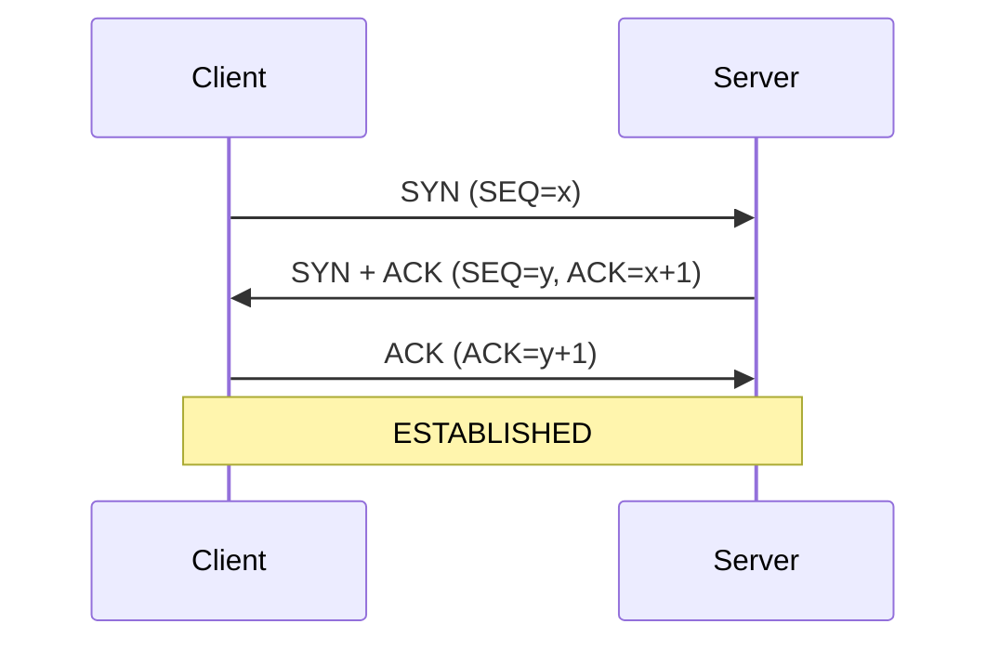
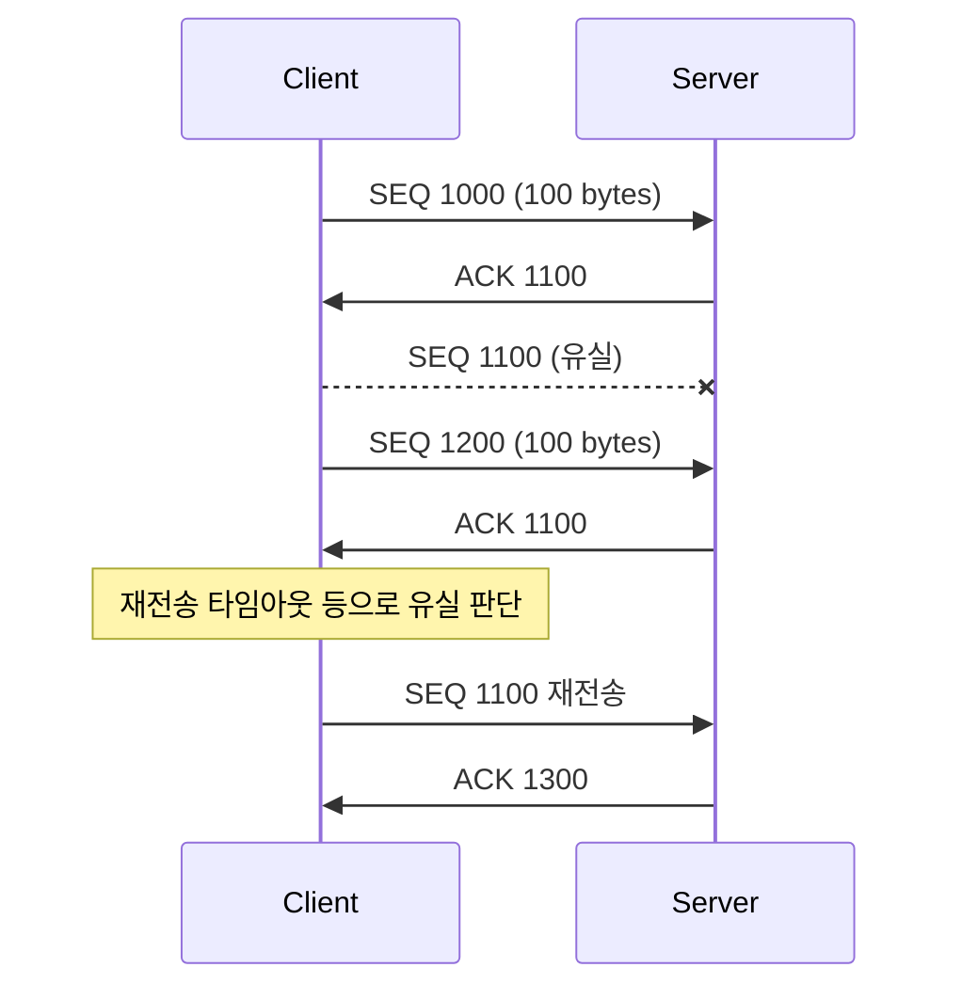
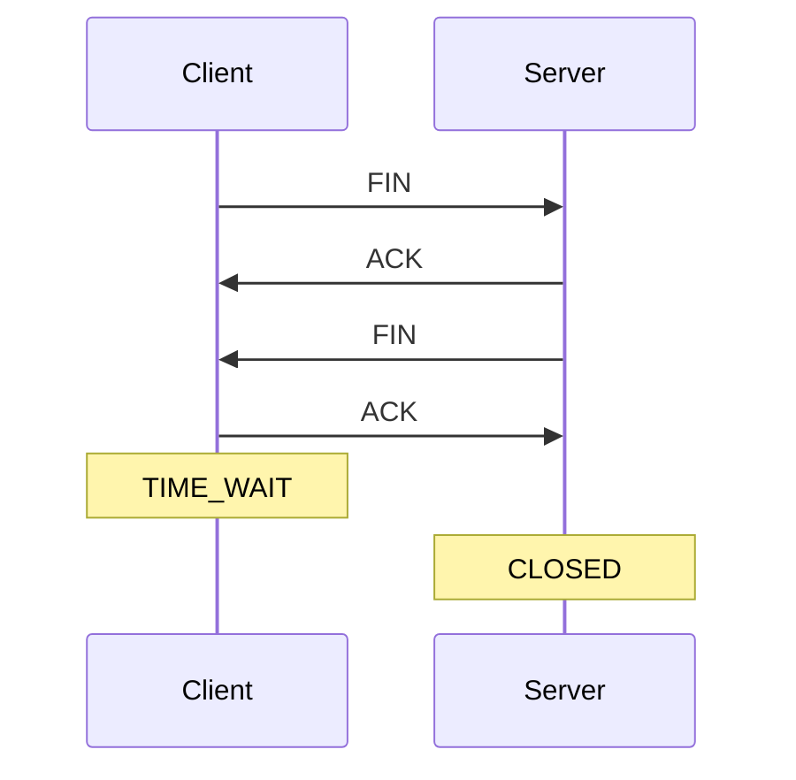

# TCP (Transmission Control Protocol)

## 개념

TCP(Transmission Control Protocol)는 연결 지향형 전송 계층 프로토콜로, 신뢰성 있고 순서가 보장되는 양방향 바이트 스트림을 제공한다.

| 기능 | 설명 |
| --- | --- |
| 연결 수립 | 데이터 전송 전에 양쪽 TCP 연결 상태와 초기 시퀀스 번호를 동기화 |
| 순서 보장 | Sequence Number로 데이터의 바이트 순서 관리 |
| 재전송 | ACK, 타임아웃 등을 이용해 유실된 데이터 재전송 |
| 흐름 제어 | 수신자의 버퍼 여유를 고려해 전송량 조절 |
| 혼잡 제어 | 네트워크 혼잡 상태를 고려해 전송량 조절 |
| 오류 검출 | 체크섬으로 전송 중 손상 검출 |
| 전이중 통신 | 연결 양쪽에서 독립적으로 데이터 송수신 가능 |

## 동작 원리

### 3-Way Handshake — 연결 수립

TCP 연결 수립에 성공한 후 HTTP 요청 등을 전송할 수 있다. 이미 맺어진 연결을 재사용하는 경우 요청마다 새로운 Handshake를 수행하지 않는다.

### 데이터 분할과 재전송

TCP는 데이터를 적절한 크기로 나누고 TCP 헤더를 추가해 세그먼트를 만든다. 헤더에는 출발지/목적지 포트, Sequence Number, ACK Number, Flags, Window Size, Checksum 등이 포함된다. 기본 헤더는 20바이트이며 옵션에 따라 길어진다.

예시: 100바이트씩 세 번 전송하며 두 번째 세그먼트가 유실된 경우.

`ACK 1100`은 현재까지 연속된 데이터가 1099번 바이트까지 수신되었으며 다음으로 1100번 바이트를 기대한다는 의미다. 위 예시는 수신 측이 순서가 뒤바뀐 데이터를 보관하고 있는 경우다.

TCP는 데이터 유실을 복구하지만 네트워크가 장시간 끊어지면 최종적으로 연결에 실패할 수 있다. 또한 TCP의 ACK는 상대 운영체제의 TCP 수신을 의미하며 업무 로직 처리나 DB 커밋 성공까지 보장하지 않는다.

### 흐름 제어와 혼잡 제어

| 구분 | 흐름 제어 (Flow Control) | 혼잡 제어 (Congestion Control) |
| --- | --- | --- |
| 고려 대상 | 수신 측 | 네트워크 경로 |
| 목적 | 수신 버퍼 초과 방지 | 네트워크 과부하 완화 |
| 주요 개념 | 수신 윈도우(rwnd) | 혼잡 윈도우(cwnd) |

### 4-Way Handshake — 연결 종료

TCP는 양방향을 각각 종료할 수 있다. 위 과정은 클라이언트가 먼저 정상 종료를 시작하는 일반적인 예시이며, FIN과 ACK가 합쳐지는 등 실제 종료 형태는 달라질 수 있다. RST는 연결을 강제로 초기화하는 데 사용된다.

## TCP와 UDP 비교

| 항목 | TCP | UDP |
| --- | --- | --- |
| 연결 수립 | 필요 | 불필요 |
| 순서/재전송 보장 | 제공 | 자체 제공하지 않음 |
| 데이터 경계 | 바이트 스트림, 메시지 경계 없음 | 데이터그램 단위 |
| 오버헤드 | 상대적으로 큼 | 상대적으로 작음 |
| 사용 사례 | HTTP/1.1, HTTP/2, FTP | DNS, 실시간 음성·영상, QUIC |

UDP 기반 응용 프로토콜이 자체적으로 신뢰성이나 혼잡 제어를 구현할 수도 있다(예: QUIC).

## 면접 질문

**Q. TCP는 어떻게 신뢰성을 확보하나요?**

A. Sequence Number와 ACK Number를 이용해 순서와 수신 여부를 관리하고, 유실된 데이터를 재전송합니다.

**Q. 3-Way Handshake란 무엇인가요?**

A. SYN, SYN+ACK, ACK를 교환하여 초기 시퀀스 번호를 동기화하고 TCP 연결을 수립하는 과정입니다.

**Q. 흐름 제어와 혼잡 제어의 차이는 무엇인가요?**

A. 흐름 제어는 수신 측의 버퍼 여유를, 혼잡 제어는 네트워크의 혼잡 상태를 고려합니다.

**Q. TCP ACK를 받으면 업무 처리가 성공한 것인가요?**

A. 아닙니다. 상대 TCP가 데이터를 수신했다는 의미이며 업무 처리 성공은 별도의 응용 계층 응답으로 확인해야 합니다.
