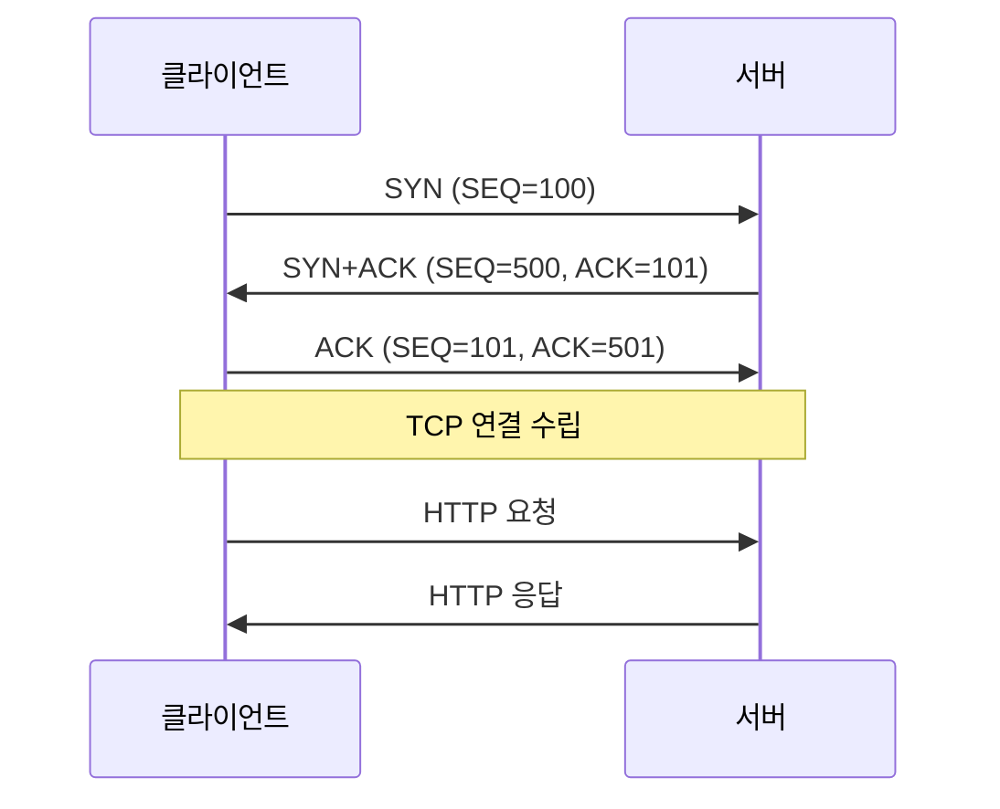

# TCP 연결 수립과 연결 재사용

## 개념

3-Way Handshake는 양쪽의 초기 순서 번호를 동기화하고 TCP 연결을 수립하는 과정이다. SYN과 ACK는 TCP 헤더의 제어 플래그이다. ACK 플래그가 설정되면 ACK Number 필드가 유효하다.

## 동작 원리



SYN은 순서 번호 하나를 소비한다. 마지막 ACK를 통해 서버도 자신의 초기 순서 번호가 클라이언트에 전달된 것을 확인한다. 연결 수립은 이후의 통신 성공을 무조건 보장하는 것은 아니다.

| 플래그 | 역할 |
| --- | --- |
| SYN | 초기 순서 번호 동기화 및 연결 수립 |
| ACK | 수신 확인 번호의 유효성 표시 |
| FIN | 자신의 데이터 전송 종료 (순서 번호 하나 소비) |
| RST | 연결 초기화 또는 강제 종료 |
| PSH | 수신 데이터의 신속한 전달 요청 |
| URG | 긴급 포인터의 유효성 표시 |

일반적인 정상 종료 흐름은 FIN → ACK → FIN → ACK이다. FIN과 ACK가 합쳐질 수도 있다.

## 연결은 언제 수립되는가?

클라이언트가 새 TCP 연결을 요청하는 시점이다. 서버를 구동하는 것만으로 클라이언트 연결이 생기지는 않는다. 서버는 LISTEN 상태에서 요청을 기다린다. 브라우저가 미리 연결(preconnect)할 수도 있으므로 반드시 API 호출 시점과 일치하지는 않는다.

```javascript
axios.get("http://localhost:1111/customer");
```

기존 연결이 없다면 TCP 연결 수립 후 HTTP 요청이 전송된다. HTTPS(TCP 기반)에서는 TLS 연결 설정도 수행한다.

## Keep-Alive와 연결 유지

HTTP/1.1은 지속 연결이 기본이다. 재사용할 수 있는 연결이 있다면 여러 HTTP 요청을 처리하면서 SYN을 다시 보낼 필요가 없다. 유휴 시간 초과, 서버 재기동, 연결 종료, 다른 목적지 포트 등으로 새 연결이 필요할 수 있다. 브라우저는 여러 연결을 동시에 사용할 수도 있다.

HTTP 지속 연결과 TCP keepalive(유휴 연결 확인용 프로브)는 다른 개념이다. 로그인 세션·인증 토큰도 TCP 연결 상태와 별개이다.

## 실습: 연결 상태 확인

Windows CMD에서 로컬 WAS가 1111 포트로 구동 중일 때:

```cmd
netstat -ano 1 | findstr :1111
```

```text
TCP  0.0.0.0:1111       0.0.0.0:0          LISTENING     1234
TCP  127.0.0.1:52341    127.0.0.1:1111     ESTABLISHED   5678
TCP  127.0.0.1:1111     127.0.0.1:52341    ESTABLISHED   1234
```

위는 가상의 출력 예시이다. 로컬 연결은 양쪽 소켓이 표시될 수 있다. 1초마다 출력되며 Ctrl+C로 종료한다.

| 상태 | 의미 |
| --- | --- |
| LISTENING | 연결 요청 대기 |
| SYN_SENT | 연결 요청 전송 |
| SYN_RECEIVED | 연결 요청 수신 후 최종 ACK 대기 |
| ESTABLISHED | 연결 수립 |
| FIN_WAIT_1 / FIN_WAIT_2 | 능동 종료 과정 |
| CLOSE_WAIT | 상대의 FIN 수신 후 로컬 종료 대기 |
| TIME_WAIT | 능동 종료 측 등의 종료 후 대기 상태 |

Chrome 개발자 도구의 Network 탭에서 Connection ID 컬럼과 Timing의 Initial connection을 확인한다. 동일한 연결 ID는 연결 재사용의 단서이다. 캐시 응답이나 HTTP/3 등은 별도로 구분해야 한다.

Wireshark에서 자신이 통제하는 실습 환경의 패킷을 분석할 때:

```text
tcp.port == 1111
tcp.port == 1111 && tcp.flags.syn == 1 && tcp.flags.ack == 0
tcp.port == 1111 && (tcp.flags.fin == 1 || tcp.flags.reset == 1)
```

localhost 실습은 루프백 인터페이스를 선택한다. 동일 포트·연결 상태의 연속 관찰은 재사용의 단서이고 실제 SYN이나 TCP 스트림을 분석하면 더 확실하다.

## 면접 질문

**Q. 3-Way Handshake는 왜 세 번 필요한가요?**

A. 양쪽 초기 순서 번호를 동기화하고 서버도 자신의 SYN이 클라이언트에 전달됐는지 확인해야 하기 때문입니다.

**Q. API 호출마다 연결 수립이 발생하나요?**

A. 아닙니다. 기존 연결을 재사용할 수 있다면 새로운 Handshake는 필요하지 않습니다.
