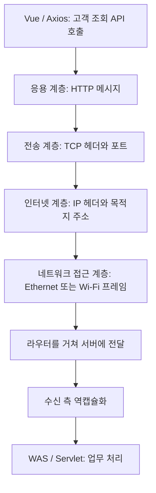

# 웹 API 호출 과정 (Web API Flow)

## 개념

Vue.js에서 Java WAS를 호출하는 상황을 가정한다. IP와 도메인은 설명용 예시다.

## 코드 예시

```javascript
axios.get('http://10.0.0.20:1111/customer', {
  params: { customerId: 100 }
});
```

HTTP/1.1에서 생성되는 요청 예시:

```http
GET /customer?customerId=100 HTTP/1.1
Host: 10.0.0.20:1111
```

## 동작 원리



- 도메인으로 호출한다면 필요 시 DNS 조회를 먼저 수행한다.
- 새로운 TCP 연결이 필요하면 3-Way Handshake를 수행한 후 HTTP 요청을 전송한다.
- HTTPS라면 TLS를 통해 암호화된 통신을 수행한다(HTTP/1.1·HTTP/2 기준).
- 각 하위 계층의 헤더 등을 추가하는 것을 캡슐화(Encapsulation), 수신 시 해석하는 것을 역캡슐화(Decapsulation)라고 한다.
- DNS 통신, TCP 연결 수립, HTTP 요청 및 응답 과정 모두에서 IP가 사용된다.
- `localhost` 통신은 물리적인 랜선 대신 루프백 인터페이스를 이용한다.

## 면접 질문

**Q. Axios로 HTTP API를 호출하면 어떤 일이 발생하나요?**

A. 필요 시 DNS를 조회하고 TCP 연결을 맺은 뒤 HTTP 메시지를 전송합니다. IP와 네트워크 접근 계층을 통해 서버에 전달되며 수신 측에서 역캡슐화 후 WAS가 요청을 처리합니다.

**Q. 캡슐화란 무엇인가요?**

A. 상위 계층 데이터를 하위 계층에서 전달하기 위해 헤더 등의 제어 정보를 추가하는 과정입니다.
