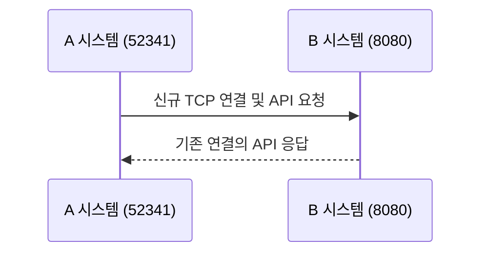
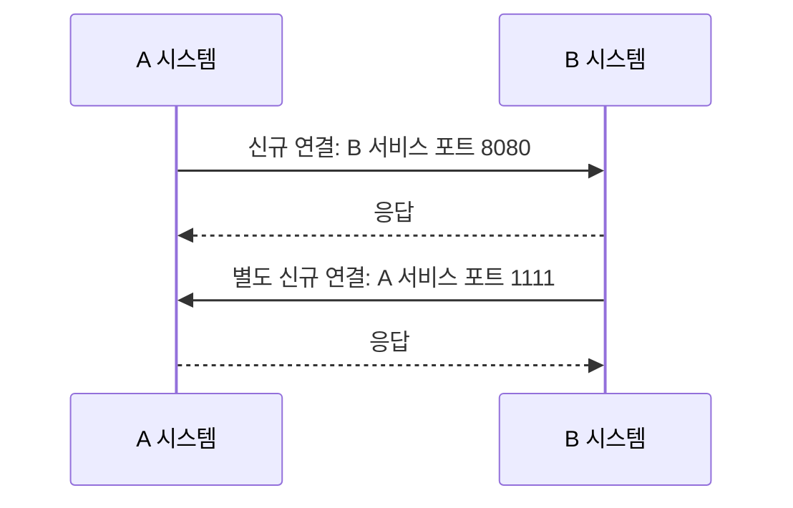

# 방화벽 (Firewall)

## 개념

방화벽은 네트워크 트래픽을 보안 정책에 따라 허용하거나 차단한다. 실무에서 '방화벽 해제'는 보통 방화벽 전체를 끄는 것이 아니라 특정 통신 구간에 대해 허용 정책을 추가하는 것을 의미한다.

## 방화벽 신청 예시

A 시스템에서 B 시스템의 HTTPS API를 호출하는 경우:

| 항목 | 값 (가상 예시) |
| --- | --- |
| 출발지 IP | 10.0.0.10 |
| 목적지 IP | 10.0.0.100 (VIP) |
| 출발지 포트 | 임시 포트 범위 또는 정책에 따른 ANY |
| 목적지 포트 | 443 |
| 전송 프로토콜 | TCP |
| 신청 사유 | B 시스템 API 연계 |

## 단방향 정책과 양방향 정책

**CASE 1. A가 B를 호출하고 B는 응답만 하는 경우**

상태 기반 방화벽(Stateful Firewall)은 허용된 연결의 상태를 기억하여 정상적인 반환 트래픽을 일반적으로 별도 역방향 정책 없이 허용한다. 제공 시스템은 수신한 TCP 정보로 응답할 포트를 알 수 있다.

**CASE 2. 양쪽이 각각 상대 시스템을 호출하는 경우**

서로 독립된 신규 연결을 시작한다면 일반적으로 각 방향에 대한 허용 정책이 필요하다. 비상태 기반 방화벽(Stateless Firewall)은 반환 트래픽에 대한 별도 정책도 필요할 수 있다. 실제 방화벽 구성, NAT, 회사 보안 정책을 확인해야 한다.

## 타 시스템에 알려줄 정보

- 우리 시스템의 접속 URL, 서비스 IP 또는 VIP, 목적지 포트, TCP/UDP 구분.
- 실제 호출 경로와 환경(개발/검증/운영)을 확인한다.
- 기존 인터페이스 정의서, 방화벽 신청 이력, L4 설정 또는 인프라 담당자를 통해 확인한다.

## 면접 질문

**Q. 방화벽은 항상 양방향으로 신청해야 하나요?**

A. 상태 기반 방화벽은 기존 허용 연결의 반환 트래픽을 일반적으로 자동 허용합니다. 양쪽에서 각각 새 연결을 시작하면 각 방향 정책이 필요합니다.

**Q. 타 시스템에 어떤 포트를 알려줘야 하나요?**

A. 타 시스템이 실제 접근하는 서비스 IP 또는 VIP와 포트, 전송 프로토콜을 알려줘야 합니다. WAS 내부 포트와 다를 수 있습니다.
