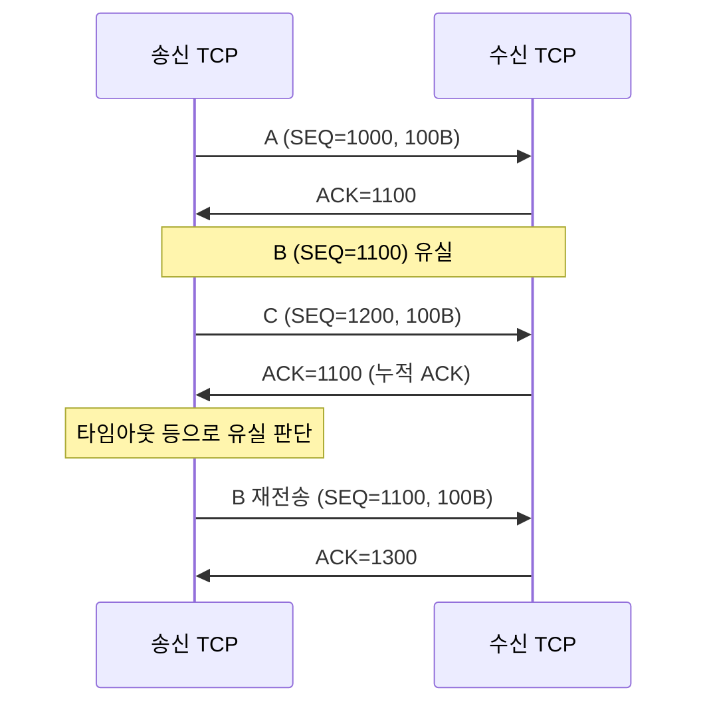

# TCP의 신뢰성: SEQ, ACK, 재전송

## 개념

3-Way Handshake는 신뢰성 있는 통신을 위한 준비 과정이다. 실제 전송의 신뢰성은 순서 번호, 수신 확인, 오류 검출, 재전송 및 순서 복원 등을 통해 확보한다.

| 기능 | 역할 |
| --- | --- |
| Sequence Number | 데이터의 시작 바이트 번호 |
| ACK Number | 다음으로 수신하기를 기대하는 연속 바이트 번호 |
| Retransmission | 유실된 데이터 재전송 |
| Checksum | 전송 데이터 오류 검출 |
| Flow Control | 수신자 버퍼에 맞춰 전송량 조절 (rwnd) |
| Congestion Control | 네트워크 혼잡에 맞춰 전송량 조절 (cwnd) |

## 동작 원리

수신자는 순서 번호를 통해 빠진 데이터와 중복을 확인할 수 있다. 송신자는 ACK 및 재전송 타임아웃 등의 정보를 바탕으로 유실을 판단한다. ACK는 일반적으로 누적 수신 확인이며, SACK 옵션으로 비연속적으로 받은 범위를 알려줄 수도 있다.

| 데이터 | 순서 번호 | 최초 결과 |
| --- | --- | --- |
| A: 100 Byte | 1000~1099 | 수신 |
| B: 100 Byte | 1100~1199 | 유실 |
| C: 100 Byte | 1200~1299 | 수신 |

C가 수신 버퍼에 유지되었다고 가정한 예시이다. B가 복구되면 1299번까지 연속 수신한 상태가 된다. 수신 TCP는 애플리케이션에 순서대로 바이트를 전달한다. 실제 ACK의 시점과 개수는 구현 및 상황에 따라 달라진다.

## 실무 예시

업무 데이터 100건을 전송할 때 TCP ACK는 상대 TCP가 바이트를 수신했다는 뜻이지, 상대 애플리케이션의 DB 저장이나 업무 처리가 성공했다는 의미가 아니다. 업무 성공 여부는 HTTP 응답이나 별도 업무 처리 결과로 확인해야 한다.

TCP 역시 장애가 계속되면 실패할 수 있다. 재시도할 때 중복 업무 처리를 막는 문제는 애플리케이션 차원에서 고려한다.

## 면접 질문

**Q. TCP는 왜 신뢰성 있는 프로토콜인가요?**

A. 연결 수립으로 초기 순서 번호를 동기화하고, 순서 번호와 ACK, 오류 검출, 유실 데이터 재전송 및 순서 복원을 통해 신뢰성 있는 바이트 스트림을 제공하기 때문입니다.

**Q. Flow Control과 Congestion Control의 차이는?**

A. 흐름 제어는 수신자의 버퍼 상황을, 혼잡 제어는 네트워크 혼잡 상황을 고려합니다.
