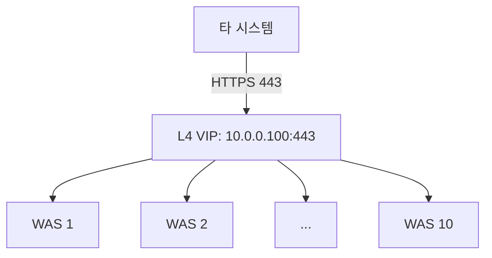

# L4 스위치와 로드밸런싱 (Load Balancing)

## 개념

로드밸런서(Load Balancer)는 여러 서버에 트래픽을 분산하여 부하 분산과 서비스 가용성 확보에 도움을 준다. 내부 시스템 간 호출에서도 사용될 수 있지만 모든 시스템이 반드시 로드밸런서를 거치는 것은 아니다.

## WAS가 10대인 경우

- 직접 호출: 호출자가 10대 모두에 접근해야 한다면 해당 IP와 서비스 포트 모두에 대한 접근 허용이 필요하다. 반드시 신청서를 10개 작성하는 것은 아니며 정책 또는 IP 그룹으로 묶을 수 있다.
- L4 경유: 일반적으로 호출자는 L4의 VIP와 서비스 포트만 알면 된다. 내부적으로 로드밸런서와 실제 백엔드 사이의 통신은 별도로 허용되어 있어야 한다.

위 구조는 설명용이며 실제 환경에서는 WEB 서버나 L7 프록시가 중간에 존재할 수 있다. L4의 VIP 포트와 백엔드 서비스 포트도 서로 다를 수 있다.

## 스위치 및 로드밸런서 구분

| 구분 (OSI 기준) | 주요 판단 정보 | 대표 역할 |
| --- | --- | --- |
| L2 | MAC 주소 | 로컬 네트워크 프레임 전달 |
| L3 | IP 주소 | 네트워크 간 라우팅 |
| L4 | IP, TCP/UDP 포트 등 | 연결/흐름 단위 부하 분산 |
| L7 | HTTP URL, 헤더, 쿠키 등 | 응용 프로토콜 기반 요청 분산 |

L4는 일반적으로 HTTP URL까지 해석하지 않는다. L7은 `/customer`, `/payment` 같은 경로를 기준으로 서로 다른 서버 그룹에 전달할 수 있다.

관련 용어:

- VIP (Virtual IP): 호출자가 접근하는 대표 가상 IP.
- RIP (Real IP): 로드밸런싱 문맥에서 실제 백엔드 서버 IP를 뜻하기도 한다.
- Health Check: 정상 동작 여부를 점검해 장애 서버를 신규 연결/요청 분산 대상에서 제외하는 기능.
- Round Robin: 순차적 분산. Least Connections: 연결 수가 적은 서버에 우선 분산.

## 면접 질문

**Q. L4와 L7의 차이는 무엇인가요?**

A. L4는 IP와 TCP/UDP 포트 등을 기준으로 연결을 분산하고, L7은 HTTP 경로와 헤더 등의 응용 계층 정보를 이용해 요청을 분산합니다.

**Q. WAS가 10대면 방화벽을 10개 신청해야 하나요?**

A. 10대 모두를 직접 호출할 경우 해당 IP 모두에 대한 접근 허용이 필요합니다. L4를 경유하면 일반적으로 호출자는 VIP와 서비스 포트만 허용받으면 됩니다. 내부 백엔드 구간은 별도 확인합니다.
