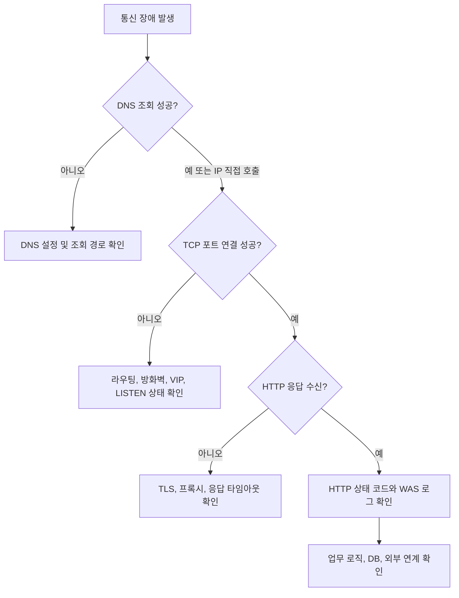

# 네트워크 장애 분석 (Network Troubleshooting)

## 개념

네트워크 자체가 끊어진 상황과 TCP 연결 실패, HTTP 또는 업무 처리 오류는 구분해야 한다.

## 장애 원인과 증상

| 원인 | 예시 |
| --- | --- |
| 물리적 장애 | 랜선 분리, 랜카드 고장, Wi-Fi 연결 해제 |
| 네트워크 장비 장애 | 라우터, 스위치, 로드밸런서 장애 |
| 라우팅 또는 DNS 장애 | 잘못된 경로, 도메인 조회 실패 |
| 방화벽 정책 | 신규 연결 차단, 연결 유휴 시간 만료 |
| 네트워크 혼잡 | 지연, 패킷 유실, 재전송 증가 |
| 서버/애플리케이션 장애 | OS 다운, WAS 종료, 서비스 포트 미구동 |
| 업무 처리 지연 | SQL 지연, 외부 연계 지연, 스레드/커넥션 풀 부족 |

## 장애 분석 절차

실제 요청을 보내는 출발지 서버에서 먼저 테스트한다. 개발 PC의 통신 성공은 운영 서버의 통신 성공을 보장하지 않는다. 다음 명령어의 IP, 포트, URL은 가상 예시이므로 권한 있는 테스트 환경의 값으로 변경한다.

| 순서 | 확인 대상 | Windows | Linux |
| --- | --- | --- | --- |
| 1 | DNS 조회 | `nslookup api.example.com` | `nslookup api.example.com` |
| 2 | ICMP 접근 | `ping 10.0.0.100` | `ping -c 4 10.0.0.100` |
| 3 | TCP 포트 연결 | `Test-NetConnection 10.0.0.100 -Port 443` (PowerShell) | `nc -vz 10.0.0.100 443` |
| 4 | 경로 확인 (필요 시) | `tracert 10.0.0.100` | `traceroute 10.0.0.100` |
| 5 | HTTP 요청 | `curl.exe -v https://api.example.com/customer` | `curl -v https://api.example.com/customer` |
| 6 | 서버 포트 및 연결 상태 | `netstat -ano` | `ss -lntp`, `ss -nt` |
| 7 | 서버 및 업무 처리 | WAS/웹서버 로그 확인 | `tail -f application.log` 등 |

ICMP가 방화벽에서 차단되면 ping 실패와 관계없이 TCP 연결에 성공할 수 있다. traceroute의 `*`도 해당 장비가 응답하지 않는다는 뜻이지 반드시 그 구간의 장애를 의미하지 않는다. `nc`와 `traceroute`는 환경에 따라 설치되어 있지 않을 수 있다.



## Java에서 만날 수 있는 통신 오류

| 오류 | 가능한 원인 |
| --- | --- |
| UnknownHostException | DNS 또는 이름 해석 실패 |
| Connection refused | 포트 미구동, 명시적 연결 거부 |
| Connect timed out | 방화벽 차단, 패킷 유실, 경로 장애 등으로 연결 수립 실패 |
| Read timed out | 연결 후 정해진 시간 동안 데이터를 읽지 못함 (업무 처리 지연 등) |
| Connection reset | 상대 또는 중간 장비가 연결을 강제로 초기화 |
| Broken pipe | 종료된 연결 등에 쓰기를 시도 |
| No route to host | 라우팅 또는 접근 경로 문제 |

HTTP 401/403/404/500 등 응답이 도착했다면 적어도 응답을 생성한 장비까지는 통신이 이루어진 것이다. 반드시 최종 WAS까지 도달했다는 의미는 아니다. 502/503/504는 프록시, 백엔드 상태, 서비스 가용성, 응답 지연 등과 관련될 수 있다.

## TCP 상태 확인

Windows CMD에서 Jetty 1111번 포트 관련 연결 확인:

```cmd
netstat -ano | findstr :1111
```

| TCP 상태 | 의미 |
| --- | --- |
| LISTEN / LISTENING | 신규 연결 요청 대기 |
| SYN_SENT | SYN을 보낸 후 응답 대기 |
| SYN_RECEIVED | SYN을 수신하고 최종 ACK 대기 |
| ESTABLISHED | TCP 연결 수립 완료 |
| CLOSE_WAIT | 상대 FIN 수신 후 로컬 애플리케이션의 종료 대기 |
| TIME_WAIT | 종료 후 지연 패킷 및 최종 ACK 재전송 등에 대비 |

패킷 분석 시 SYN 응답 없음, RST 수신, Retransmission 반복, Zero Window 등을 확인하면 장애 범위를 좁힐 수 있다. 단일 증상만으로 원인을 단정하지 않고 출발지/목적지 로그, 방화벽 로그와 패킷을 함께 비교해야 한다. 운영 서버 패킷 수집 및 테스트는 반드시 보안 정책과 승인 범위를 준수한다.

## 로컬 실습 (Windows, Jetty 1111 예시)

- [ ] Jetty를 실행하고 `netstat -ano | findstr :1111`로 LISTENING 상태 확인.
- [ ] PowerShell에서 `Test-NetConnection 127.0.0.1 -Port 1111` 실행.
- [ ] CMD 또는 PowerShell에서 `curl.exe -v http://127.0.0.1:1111/` 실행 후 HTTP 상태 코드 확인.
- [ ] 요청 중 `netstat -ano`로 클라이언트 임시 포트와 서버 포트 확인. 짧은 연결은 관찰하기 어려울 수 있음.
- [ ] 로컬 Jetty를 종료하고 TCP 포트 테스트 결과와 비교.
- [ ] `nslookup example.com`으로 이름 조회 결과 확인.

## 면접 질문

**Q. API 호출 장애가 발생하면 어떻게 분석하나요?**

A. 실제 출발지 서버에서 DNS, TCP 포트, TLS/HTTP 응답을 확인한 후 라우팅, 방화벽, 로드밸런서, WAS 로그 등을 비교하여 장애 범위를 좁힙니다.

**Q. Connect Timeout과 Read Timeout의 차이는 무엇인가요?**

A. Connect Timeout은 연결 수립 시간 초과이고, Read Timeout은 연결 후 정해진 시간 동안 데이터를 읽지 못한 경우입니다.

**Q. ping이 실패하면 네트워크가 끊어진 것인가요?**

A. 반드시 그렇지는 않습니다. ICMP만 차단되었을 수 있으므로 실제 서비스 포트 연결 여부를 별도로 확인해야 합니다.
