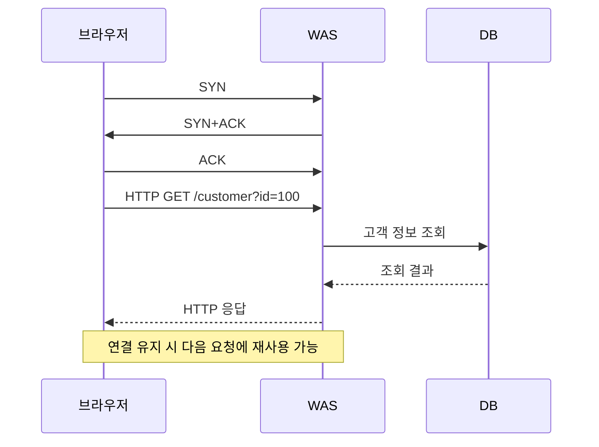

# 실제 웹 API 호출과 TCP/IP 계층

## 개념

Vue.js 화면에서 고객 정보 조회 API를 호출하는 상황을 예시로 각 계층의 동작을 연결한다.

```javascript
axios.get("http://10.0.0.20:8080/customer?id=100");
```

| 정보 | 예시 값 |
| --- | --- |
| 출발지 IP | 192.168.0.10 |
| 출발지 포트 | 52341 (자동 할당 예시) |
| 목적지 IP | 10.0.0.20 |
| 목적지 포트 | 8080 |
| 연결 | 새로운 TCP 기반 HTTP/1.1 연결 |
| 링크 | Ethernet, NAT 없음 |

목적지에 도달 가능한 사설 네트워크를 가정한다. IP 주소를 직접 지정했으므로 해당 목적지의 도메인 조회는 생략한다. 브라우저의 CORS 정책, 프록시 등은 단순화를 위해 제외한다.

## 동작 원리

1. 응용 계층: HTTP 요청을 구성한다.
2. 전송 계층: 새로운 연결이 필요하면 SYN, SYN+ACK, ACK로 연결을 수립한다. HTTP 데이터를 TCP 바이트 스트림으로 전송한다.
3. 인터넷 계층: TCP 세그먼트를 IP 패킷으로 캡슐화하고 라우팅 정보를 이용해 다음 전달 대상을 결정한다.
4. 네트워크 접근 계층: 다음 홉의 MAC 주소를 확인하고 Ethernet 프레임을 생성해 전송한다.

위 순서는 역할을 설명한 것이다. 실제로 SYN부터 IP 및 링크 계층을 거쳐 전송되며, 필요하다면 SYN 전송 전에 ARP 조회가 발생한다.

```http
GET /customer?id=100 HTTP/1.1
Host: 10.0.0.20:8080
```

### 캡슐화

```text
응용:                          [HTTP 데이터]
전송:               [TCP 헤더][HTTP 데이터]
인터넷:     [IP 헤더][TCP 헤더][HTTP 데이터]
링크: [Ethernet 헤더][IP 헤더][TCP 헤더][HTTP 데이터][FCS]
```

하나의 TCP 데이터 세그먼트를 단순화한 구조다. HTTP 메시지 하나가 여러 세그먼트로 나뉠 수 있다.

### 서버의 처리 흐름



서버에서는 역캡슐화와 TCP 순서 복원이 이루어진다. WAS가 HTTP 메시지를 해석하고 Servlet, Controller, Service 등의 업무 로직을 수행한다. DB 호출은 별도의 통신 연결일 수 있다. HTTP 응답도 하위 계층을 거쳐 반환된다.

## 개발자와 운영체제의 역할

| 작업 | 담당 주체 |
| --- | --- |
| 데이터 형태, 업무 로직, 통신 규격 결정 | 개발자 / 시스템 설계 |
| HTTP 메시지 생성 및 해석 | 브라우저, 라이브러리, 웹 서버/WAS |
| TCP 연결, 출발지 포트 자동 할당 | 운영체제 TCP 스택 |
| 데이터 분할, SEQ, ACK, 재전송, 순서 복원 | TCP 스택 등 |
| IP 기반 경로 선택 및 패킷 전달 | 운영체제 / 라우터 |
| MAC 조회, 프레임 전송 | 운영체제 네트워크 스택 / NIC 등 |

## 면접 질문

**Q. API 호출 시 TCP/IP 계층은 어떻게 동작하나요?**

A. HTTP 요청이 구성되고 TCP 연결에서 신뢰성 있게 전송됩니다. IP 계층은 목적지와 경로를 결정하고 링크 계층은 다음 장비까지 프레임을 전달합니다. 수신 측은 역순으로 처리해 HTTP 요청을 해석합니다.

**Q. TCP ACK가 업무 처리 성공을 의미하나요?**

A. 아닙니다. TCP ACK는 수신 TCP의 바이트 수신 확인이며, 업무 결과는 응용 계층에서 확인해야 합니다.
